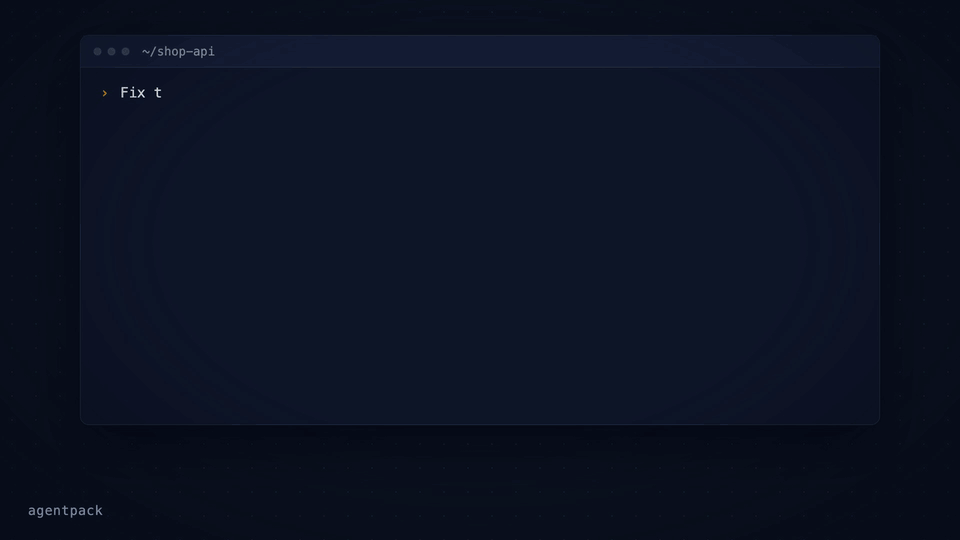

# Agentpack

[](https://www.npmjs.com/package/agentpack-cli)
[](https://github.com/ihorponom/agentpack/actions/workflows/ci.yml)
[](https://www.npmjs.com/package/agentpack-cli)
[](LICENSE)
[](https://glama.ai/mcp/servers/ihorponom/agentpack)

Repo-native task continuity for AI coding agents.

> Agent memory remembers how you work. Agentpack remembers where the task stands.

Your agent spent an hour on a task. It found the cause, rejected two approaches, and wrote down the next step. Then the context was compacted, or the chat closed. The next session starts from zero and does the same investigation again.

Agentpack keeps the task state in your repo. Connected agents record the goal, decisions, dead ends, verification evidence, and checkpoints in `.agentpack/` while they work. Then the next session loads that state and continues: the same agent after compaction, a different client, or you next week.


Here it is live. In session 1, Claude Code investigates a flaky test and records what it finds through the Agentpack MCP tools. In session 2, the next day with an empty context, the agent loads the task state and continues from where session 1 stopped:



To try the same flow by hand from the CLI, see [docs/DEMOS.md](docs/DEMOS.md).

- **Local-first.** Plain files in your repo. No cloud, no telemetry, no network calls.
- **Made for agents.** A local MCP server and generated project instructions (`AGENTS.md`, `CLAUDE.md`, Cursor rules) tell agents when to load and record state.
- **Open to people.** The CLI shows the same state, so you can inspect it, fix it, or hand it off yourself.

## How is this different from agent memory?

Claude Code memory, Codex memories, and `CLAUDE.md` or `AGENTS.md` keep how to work: your preferences, project conventions, and facts that stay true. Agentpack keeps where the work is: the goal of the current task, its constraints, decisions, dead ends, next actions, and verification result.

| | Agent memory | Agentpack |
|---|---|---|
| Holds | Preferences, conventions, long-lived facts | The state of one task |
| Lives in | The profile or account of one client | `.agentpack/` in the repo, local by default, portable with task bundles |
| Read by | That client only | Any MCP client: Claude Code, Codex, Cursor, Claude Desktop |
| Shape | Free-form notes, recalled by relevance | A Task Passport per task: goal, lifecycle, the paths it may change, and verification bound to a commit |
| Staleness | Not tied to file changes | Notes about files store the file hash, so Agentpack flags a note when its file changes |

Use both. Memory keeps how you like to work. Agentpack keeps what the task needs next.

## Quick start

Agentpack needs Node.js 20 or later.

```bash
npm install -g agentpack-cli

cd path/to/your/repo
agentpack init                     # once per repo
agentpack install claude --write   # per client: codex | claude | cursor | claude-desktop
agentpack install git-hooks --write  # optional: task gate check before each commit
```

Restart or reconnect your coding agent, and approve the Agentpack server or hooks when the client asks. From then on, the agent loads the task state when a session starts, records decisions and evidence while it works, and creates checkpoints at meaningful points.

To check the setup, run `agentpack doctor`. To see the task state yourself, run `agentpack resume --preset agent --query "<topic>"`.

In a Git repository, `init` adds the local Agentpack files to `.git/info/exclude`. The list includes `.agentpack/`, `.mcp.json`, `.claude`, `.codex`, `.cursor`, `AGENTS.md`, and `CLAUDE.md`. Agentpack does not change your `.gitignore`. Files that Git already tracks stay tracked.

For each client, [docs/INTEGRATIONS.md](docs/INTEGRATIONS.md) shows what the installer writes and why.

## How it works

1. When a session starts, the agent loads a compact summary: the current Task Passport, recent checkpoints, decisions, and source conclusions.
2. While it works, the agent records what is worth keeping: decisions, failed approaches, and verification evidence. It can also record a source conclusion: a short note about what a file does, stored with the file hash. If the file changes later, Agentpack flags the conclusion. A matching hash shows that the file is unchanged, not that the conclusion is correct.
3. At a natural stop, the agent creates a checkpoint with the status, the next actions, and the Git state.
4. The next session, in any MCP client, continues from that state. It does not rebuild the task from chat history.

Each task has a **Task Passport**: the goal, status, constraints, write scope (the paths the task may change), next actions, and verification. You can start, park, switch, and finalize tasks, so each handoff is explicit.

The **task gate** checks edits against the current Passport. The client installers add native hooks for Claude Code, Codex, and Cursor. `install git-hooks` adds a pre-commit check. By default, the gate only warns. Set `"gateMode"` in `.agentpack/config.json` to `"block"` to stop edits outside the write scope or outside an active task, or to `"off"` to turn the gate off. Hooks are a guardrail, not a sandbox. See [docs/CLI.md](docs/CLI.md).

The summary stays inside a token budget. The agent gets the useful state back, not the full history.

## More features

- **Task bundles.** Export a task to one JSON file, and import it in a fresh clone or on another machine. See [docs/TASK-PASSPORT.md](docs/TASK-PASSPORT.md#portable-bundle-contract).
- **Tasks across repositories.** One Passport can cover [changes in several repositories](docs/TASK-PASSPORT.md#changes-across-repositories), each with its own write scope.
- **Monorepo focus.** Give each part of a monorepo (`api/`, `frontend/`, `cron/`) short tasks with their own write scope. The task gate warns when the agent leaves that part.
- **Usage reports.** `agentpack usage report` reads local Claude Code and Codex transcripts and shows the token use of a task, including the Agentpack share. Nothing leaves your machine.
- **Read-only inspector.** `agentpack tui` shows tasks, evidence, and checkpoints in the terminal. See [docs/TUI.md](docs/TUI.md).
- **Builder subagent.** Codex, Claude Code, and Cursor installs include an optional builder for larger implementation work. The main agent says what it will hand off before it uses the builder. Small tasks stay with the main agent.

## When it helps

- The context is compacted in the middle of a task, and the next turn needs the state back.
- You start a new chat on a task that is still open.
- You change between Claude Code, Cursor, Codex, or another MCP client.
- You come back to a refactor or a bug fix days later.
- Another agent continues from your checkpoint.

Agentpack context also uses tokens. The compact output keeps the task state available without the full ledger history.

## Security posture

- Zero runtime dependencies, exact dev dependencies, a committed lockfile, and `ignore-scripts=true`.
- No telemetry and no network calls in normal CLI or MCP operation.
- Best-effort redaction of values that look like secrets in stored context and handoff output.
- GitHub Actions publishes each release with [npm provenance](https://docs.npmjs.com/generating-provenance-statements) (Trusted Publisher, no long-lived tokens). To verify, run `npm audit signatures`.

See [SECURITY.md](SECURITY.md) for the full policy, including what Agentpack reads outside the repo.

## Documentation

- [docs/INTEGRATIONS.md](docs/INTEGRATIONS.md): setup for Codex, Claude Code, Cursor, Claude Desktop, and Git hooks
- [docs/TASK-PASSPORT.md](docs/TASK-PASSPORT.md): task lifecycle, handoffs, additional repositories, and task bundles
- [docs/CLI.md](docs/CLI.md): full CLI reference, budgets, and manual workflows
- [docs/MCP.md](docs/MCP.md): MCP server contract and tools
- [docs/DEMOS.md](docs/DEMOS.md): short continuity demos to run yourself
- [docs/TUI.md](docs/TUI.md): the read-only terminal inspector
- [docs/LEDGER-HYGIENE.md](docs/LEDGER-HYGIENE.md): keep the ledger small and useful

## Contributing

Clone the repo and use Node.js 20 or later:

```bash
npm ci --ignore-scripts
npm test
npm run mcp:smoke
node dist/src/agentpack.js --help
```

See [docs/SETUP.md](docs/SETUP.md) for the development setup and [docs/RELEASING.md](docs/RELEASING.md) for the release steps.

---

Mirror: [Codeberg](https://codeberg.org/ihorponom/agentpack). Issues, releases, and npm provenance stay on GitHub.
